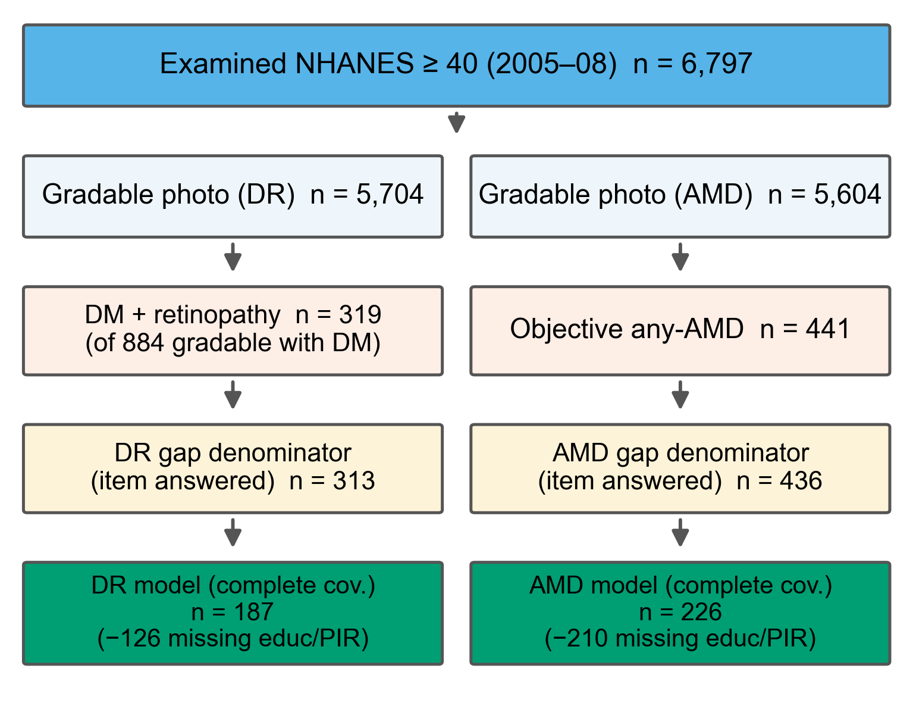
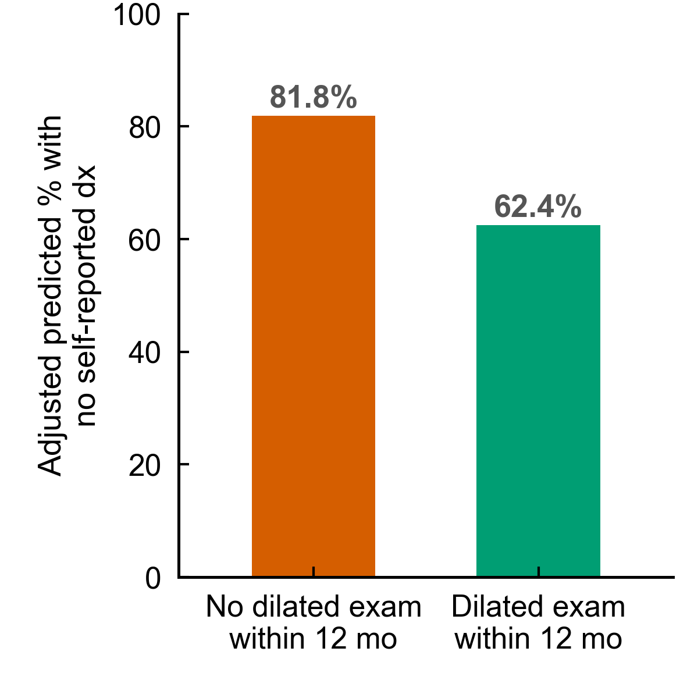

# Supplementary Materials

## Objectively graded retinal disease, self-reported diagnosis, and eye-care utilisation in US adults (NHANES 2005–2008)

*All supplementary values are generated by `code/survey_analysis_v4.R` (core), `code/survey_analysis_v5.R`, `code/survey_analysis_v6.R` (construct-validity and robustness extensions) and `code/survey_analysis_v7.R` (per-model degrees-of-freedom audit, IPW weight decomposition, severity-adjusted AMD age model and late-AMD phenotype check), consolidated in `results/tables/numbers_v7.csv`, and audited by `code/verify_v7.py`, which enforces the sample-denominator assertions against the raw analytic dataset, verifies the per-model design/residual degrees-of-freedom and CI/P consistency, and re-checks every in-text value. Every diagnosis-discordance denominator is restricted to participants who answered the relevant self-report item (responders-only). Proportion confidence intervals are design-based logit-transformed (`svyciprop(method="logit")`) and lie within 0–100%; adjusted-odds-ratio intervals use the design-based t critical value on each model's residual degrees of freedom, matching the Wald P values.*

---

### Supplementary Table S1. Screening, per-variable missingness, and model-denominator reconciliation

**(a) Cohort build-up (NHANES 2005–2008, examined adults ≥40).**

| Step | DR cohort | AMD cohort |
|---|---|---|
| Examined adults ≥40 with retinal photography | 6,797 | 6,797 |
| Gradable retinal image (worse eye) | 5,704 | 5,604 |
| Objectively graded disease present | 319 (diabetes + retinopathy) | 441 (any AMD) |
| Answered the self-report diagnosis item → **primary gap denominator** | **313** | **436** |
| Non-responders excluded | 6 | 5 |

**(b) Per-variable missingness among gap-eligible responders.**

| Cohort | Eligible (responders) | Missing education | Missing income | Missing insurance | Missing usual source | Missing dilated-exam item |
|---|---|---|---|---|---|---|
| DR | 313 | 102 | 30 | 0 | 0 | 0 |
| AMD | 436 | 188 | 42 | 1 | 0 | 377 |

*The AMD dilated-exam item is missing for 377/436 because `DIQ360` is asked only of people with diabetes; only 59 AMD responders were diabetic, which is why the eye-care–awareness analysis cannot be run for AMD.*

**(c) Model-denominator reconciliation.**

| Quantity | DR | AMD |
|---|---|---|
| Descriptive diagnosis-gap denominator (responders) | 313 | 436 |
| Core complete-case model (education AND income complete) | 187 | 226 |
| Core + insurance (education, income, insurance complete) | 187 | — |
| Missing-indicator sensitivity model (retains all responders; income median-filled + income & education missingness flags) | 313 | — |
| Multiple-imputation model (m = 20, Rubin-pooled; retains all responders) | 313 | — |
| Reduced model (education dropped, income kept) | 283 | — |
| Education-complete subset — **descriptive count only, not a fitted model** | 211 | — |
| Insurance descriptive (coverage known) | — | 225 |

*The reduction from 313 (436) to the core model 187 (226) is driven by missing education and income. The single fitted missing-indicator model retains **all 313** responders by median-filling income and adding missingness indicators for both income and education; it is therefore distinct from the education-complete count of 211, which is reported only to explain attrition and is not itself a model. Because a missing-indicator approach cannot exclude informative (MNAR) missingness, it is used as a stability check, not as evidence that missingness is ignorable. **AMD insurance descriptive (moved here from the main-text model table because it is not a fitted term):** among the 225 AMD responders with a known coverage status — a subset of the 226 core cases in which insurance was recorded, not all 436 AMD responders — 177 of 211 insured (83.9%) and all 14 of 14 uninsured reported no prior diagnosis. Because the uninsured stratum was perfectly separated from the outcome, an insured-versus-uninsured odds ratio is not estimable in a conventional logistic model for AMD; the AMD model therefore excludes insurance, and this table records the raw descriptive contrast only.*

### Supplementary Table S2. Diagnosis-gap robustness: clinical severity tiers and non-response extreme-scenario bounds

**(a) Three-tier severity view of the AMD diagnosis gap (survey-weighted % with no self-reported diagnosis; logit CIs).**

| Tier | Unweighted n | % (95% CI) |
|---|---|---|
| Any AMD (primary, all stages) | 436 | 82.2 (77.3–86.2) |
| Early AMD | 381 | 87.9 (84.4–90.6) |
| Late AMD (clinically relevant) | 55 | 41.4 (25.3–59.6) |
| Geographic atrophy (high-severity) | 32 | 50.3 (26.6–73.9) |
| Exudative / neovascular AMD (high-severity) | 23 | 27.7 (8.0–62.9) |

*Because the late-AMD and high-severity strata are small, these are reported as design-weighted proportions with confidence intervals, without additional multivariable modelling. The geographic-atrophy vs neovascular difference has wide, overlapping intervals and should not be read as an established group difference. The subtype counts are mutually exclusive rather than double-counted: NHANES records the two late-AMD phenotypes as separate flags (`OPDUGA`, `OPDUEXU`), and the worse-eye summary assigned each participant to a single late-AMD category. We verified directly that **no participant was flagged with both geographic atrophy and neovascular disease in the same worse eye** (0 of 55), so 32 + 23 = 55 reproduces the late-AMD total exactly. Because a single worse eye can carry only one graded phenotype, this rule could in principle undercount a participant with geographic atrophy in one eye and neovascular disease in the other; the NHANES worse-eye grading convention does not let us detect that bilateral-mixed pattern, so the two subtype counts are best read as an approximately mutually exclusive partition rather than a clinically exhaustive phenotyping.*

**(b) Extreme-scenario non-response bounds (survey-weighted, not simple count arithmetic).**

| Cohort | Responders-only (primary) | If all non-responders were "diagnosed" | If all non-responders were "undiagnosed" |
|---|---|---|---|
| DR (n = 319 base; 6 non-responders) | 70.2 (63.8–75.9) | 69.2 (62.5–75.2) | 70.6 (64.4–76.1) |
| AMD (n = 441 base; 5 non-responders) | 82.2 (77.3–86.2) | 81.6 (76.7–85.7) | 82.3 (77.5–86.3) |

*Bounds were recomputed with the full survey weights (not by adding/subtracting people from a percentage): non-responders were assigned y = 0 (all diagnosed) then y = 1 (all undiagnosed) and the weighted logit proportion re-estimated. The primary responders-only estimate lies within the bounds and the bound width is ~1–1.4 percentage points, so the headline gaps are not driven by the few diagnosis-item non-responders.*

### Supplementary Table S2b. Design degrees of freedom contributing to each analytic subset

| Analytic subset | Unweighted n | Number of strata | Total number of PSUs | Design degrees of freedom (`survey::degf`) |
|---|---|---|---|---|
| DR responders (313) | 313 | 31 | 59 | 28 |
| AMD responders (436) | 436 | 31 | 61 | 30 |
| DR core complete-case model (187) | 187 | 30 | 52 | 22 |
| AMD core complete-case model (226) | 226 | 31 | 60 | 29 |

*PSUs are counted as unique stratum×PSU combinations. NHANES samples two PSUs per stratum, so the total PSU count in a subset is roughly twice the number of strata (59–62), not 2; `SDMVPSU` itself only carries the within-stratum labels 1 and 2. Design degrees of freedom equal (total PSUs − strata), and are reduced further where a complete-case subset leaves a stratum with a single contributing PSU. These values were obtained with `survey::degf()` on each subset design. **Design df, model residual df and the `summary.svyglm` df are distinct quantities and are not interchangeable**: `survey` performs regression inference at the model *residual* df, which equals `degf(design) − model rank + 1`. Table S2c exports, for every model reported in this study, the design df, the model rank, the resulting residual df, the exact t-multiplier `qt(0.975, df)`, and the coefficient/SE/aOR/CI/raw-P/Holm-P all read from the *same fitted model object*, so that confidence intervals and P values cannot drift apart from one another. For the DR eye-care model the residual df is 13 (degf 22 − rank 10 + 1), and this single df reproduces both the reported exam odds ratio 0.30 (0.10–0.92) and P = 0.038.*

### Supplementary Table S2c. Per-model degrees-of-freedom and estimate audit (all columns from one fitted model object)

| Model | n | Design df (`degf`) | Rank | Residual df | CI multiplier t(0.975, df) | Term | aOR (95% CI) | Raw P | Holm P |
|---|---|---|---|---|---|---|---|---|---|
| PRIMARY DR core | 187 | 22 | 6 | 17 | 2.110 | Age (per yr) | 0.99 (0.96–1.02) | 0.65 | 1.00 |
| | | | | | | Male | 1.29 (0.45–3.71) | 0.62 | 1.00 |
| | | | | | | Education <HS | 0.67 (0.28–1.61) | 0.35 | 1.00 |
| | | | | | | Race non-White | 1.57 (0.49–5.07) | 0.43 | 1.00 |
| | | | | | | Poverty-income ratio | 1.34 (0.92–1.96) | 0.119 | 0.594 |
| PRIMARY AMD core | 226 | 29 | 6 | 24 | 2.064 | Age (per yr) | 0.93 (0.89–0.96) | 0.00061 | 0.0031 |
| | | | | | | Male | 0.99 (0.32–3.08) | 0.98 | 1.00 |
| | | | | | | Education <HS | 0.82 (0.31–2.21) | 0.69 | 1.00 |
| | | | | | | Race non-White | 1.56 (0.29–8.52) | 0.59 | 1.00 |
| | | | | | | Poverty-income ratio | 0.88 (0.60–1.31) | 0.52 | 1.00 |
| SUPP DR + insurance | 187 | 22 | 7 | 16 | 2.120 | Poverty-income ratio | 1.39 (0.96–2.00) | 0.077 | 0.463 |
| | | | | | | Uninsured | 1.87 (0.57–6.13) | 0.28 | 1.00 |
| ANALYSIS A (eye-care) | 187 | 22 | 10 | 13 | 2.160 | Poverty-income ratio | 1.49 (1.04–2.15) | 0.033 | 0.261 |
| | | | | | | Uninsured | 0.72 (0.17–2.97) | 0.62 | 1.00 |
| | | | | | | **Recent dilated exam** | **0.30 (0.10–0.92)** | **0.038** | **0.266** |
| | | | | | | Severity grade 3 | 0.43 (0.15–1.21) | 0.102 | 0.614 |
| | | | | | | Severity grade 4 | 0.05 (0.01–0.24) | 0.0011 | 0.0099 |

*The aORs, CIs, SEs, raw P and Holm P in every row were extracted programmatically from the single `svyglm` (quasibinomial) object for that model (see `t_model_audit_v7.csv` / keys `audit|*` and `audit_df|*` in `numbers_v7.csv`); none were hand-filled or computed from a different df than the P value. The 95% CI uses `exp(coef ± t(0.975, dfres)·SE)` at the residual df in the same row, and the raw P is the Wald-`t` P from `summary()` at that same df — the two are guaranteed mutually consistent. Holm adjustment is applied within each model's set of tested terms. The two models whose headline figures the reviewer asked us to re-verify are the DR core model (poverty-income 1.34) and the DR eye-care model (recent dilated exam 0.30, 0.10–0.92, P = 0.038, Holm P = 0.266, residual df = 13): both are reproduced here exactly as reported in the main text, from one model object.*

### Supplementary Table S3. Diagnosis discordance by severity and age (survey-weighted % with no self-reported diagnosis; responders; logit CIs)

| Stratum | Unweighted n | % (95% CI) |
|---|---|---|
| **Self-reported diabetic-eye diagnosis by severity (% diagnosed)** | | |
| No gradable retinopathy (OPDURL4 = 1) | 560 | 16.6 |
| Mild NPDR (OPDURL4 = 2) | 197 | 21.9 |
| Moderate NPDR (OPDURL4 = 3) | 85 | 35.6 |
| Severe-or-proliferative retinopathy (OPDURL4 = 4) | 31 | 84.3 |
| **DR diagnosis gap by severity (% undiagnosed)** | | |
| Mild NPDR | 197 | 78.1 (71.3–83.7) |
| Moderate NPDR | 85 | 64.4 (48.3–77.8) |
| Severe-or-proliferative retinopathy | 31 | 15.7 (5.0–39.7) |
| Moderate-or-worse (pooled) | 116 | 53.4 (38.7–67.5) |
| **AMD diagnosis gap by stage and phenotype** (full tiers in Table S2) | | |
| Early AMD | 381 | 87.9 (84.4–90.6) |
| Late AMD | 55 | 41.4 (25.3–59.6) |
| **AMD diagnosis gap by age** | | |
| 40–59 | 75 | 99.1 (95.6–99.8) |
| 60–74 | 165 | 86.6 (77.8–92.3) |
| ≥75 | 196 | 66.7 (60.1–72.6) |
| ≥50 | 406 | 79.7 (75.0–83.8) |
| **DR diagnosis gap by age** | | |
| 40–59 | 101 | 73.4 (59.9–83.6) |
| 60–74 | 156 | 66.5 (58.6–73.6) |
| ≥75 | 56 | 71.1 (56.0–82.7) |

*The severity responder counts (560/197/85/31 = 873) are the diabetes-restricted gradable participants who answered `DIQ080`; the retinopathy subset (197+85+31 = 313) equals the primary DR gap denominator. Severity is a grading category, not a treatment indication. Early and late AMD gaps are computed directly from their own responder sets (381 and 55), not by subtracting one percentage from another.*

### Supplementary Table S4. Missing-data sensitivity for the DR cohort: complete-case, missing-indicator, reduced models, and multiple imputation

Four handling strategies for the two high-missingness covariates (education, income). The complete-case column is the core model (n = 187, education and income required complete); the missing-indicator column retains all 313 responders by median-filling income (with an income-missingness flag) and assigning missing education the "HS-or-more" placeholder with an education-missingness flag; the reduced column drops education and keeps income (n = 283); the multiple-imputation column uses chained equations (m = 20) over outcome, demographics, severity, cycle, income and education, pooled with Rubin's rules within the survey design (n = 313).

| Term | Complete-case (n = 187) aOR (95% CI), Holm P | Missing-indicator (n = 313) aOR (95% CI), P | Reduced — drop education (n = 283) aOR (95% CI), P | Multiple imputation (m = 20, n = 313) aOR (95% CI), P |
|---|---|---|---|---|
| Age (per year) | 0.99 (0.96–1.02), 1.00 | 1.00 (0.97–1.03), 0.935 | 1.00 (0.97–1.03), 0.842 | 1.00 (0.98–1.03), 0.776 |
| Male vs female | 1.29 (0.45–3.71), 1.00 | 0.93 (0.44–1.96), 0.832 | 0.80 (0.36–1.75), 0.558 | 0.99 (0.49–2.01), 0.987 |
| Education <HS vs ≥HS | 0.67 (0.28–1.61), 1.00 | 0.86 (0.38–1.95), 0.711 | excluded by design | 0.76 (0.33–1.79), 0.527 |
| Race non-White vs White | 1.57 (0.49–5.07), 1.00 | 1.27 (0.72–2.25), 0.397 | 1.18 (0.67–2.06), 0.553 | 1.38 (0.82–2.34), 0.221 |
| Poverty-income ratio | 1.34 (0.92–1.96), 0.59 | 1.48 (1.10–1.99), 0.013 (median-filled) | 1.46 (1.08–1.97), 0.017 | 1.38 (1.02–1.87), 0.037 |
| Income-missing indicator | — | 1.08 (0.33–3.56), 0.894 | — | — |
| Education-missing indicator | — | 0.70 (0.30–1.60), 0.375 | — | — |

*The income point estimate is above 1 in every specification (1.34–1.48), so the **direction is stable**, but its precision depends on missing-data handling: non-significant in the complete-case core model, nominally significant when education is dropped (1.46, P = 0.017), under multiple imputation (1.38, P = 0.037) and in the median-filled missing-indicator model (1.48, P = 0.013). Higher income is therefore treated as a tentative correlate with imprecise magnitude, not an established driver. Neither missingness indicator showed a statistically detectable association with the outcome in this model; however, these results do not establish that the missingness mechanism is ignorable, and multiple imputation does not reproduce the finite-population design variance, so its inference is a sensitivity check. Attrition: model entrants (n = 187) vs excluded (n = 126) were similar on the outcome (66.8% vs 68.3% with no reported diagnosis) and differed mainly in age (mean 65.2 vs 61.6 years).*

**S4b. Imputation diagnostics (DR responders, n = 313).** Missingness among responders: education 32.6%, income 9.6%; all other imputation variables (outcome, age, sex, race, insurance, severity, cycle) had 0% missing. The income aOR was above 1 in each of the 20 imputations (pooled 1.388, per-imputation range 1.24–1.49, between-imputation SD 0.048; age 1.00, sex 0.99, education 0.76, race 1.39 pooled; ranges in `numbers_v7.csv`, keys `mimi|*`). These 20 values are **not 20 independent replications** — they share the same observed data and the same imputation model and assumptions, so the tight range reflects within-imputation variability under one set of MAR-style assumptions rather than external confirmation of the income estimate. Conventional convergence diagnostics (trace plots, potential-scale-reduction, fraction-of-missing-information) were not generated for this single-model pooled analysis; the per-imputation spread reported here is therefore a limited stability check only, and the pooled inference remains a sensitivity analysis (multiple imputation does not reproduce the finite-population survey-design variance).

**S4c. Missingness-mechanism models (descriptive).** Logistic models of whether education (resp. income) is missing on age, sex, race, diabetes, insurance, the outcome and cycle. Education-missingness was associated with younger age (OR 0.94/yr, P < 0.001) and insurance status (P < 0.001) but **not** with the outcome (OR 0.995, P = 0.99). Income-missingness was associated with race/ethnicity (non-White OR 4.11, P = 0.011) but **not** with the outcome (OR 1.21, P = 0.73). Missingness was thus associated with several observed participant characteristics, supporting their inclusion in the imputation and sensitivity analyses; neither missingness model identified a statistically detectable association with the diagnosis-discordance outcome. **However, these findings do not establish a missing-at-random mechanism and cannot exclude bias due to unobserved factors** — the absence of a detectable outcome association in models of this size is not evidence that MAR holds. A further reduced model dropping **both** education and income (retaining all 313 responders) left only age, sex and race, none associated with the outcome (age aOR 0.99, sex 1.11, race 1.05; all P > 0.5). This reduced model was fitted only to describe associations with the remaining demographic covariates in the full responder sample; **because it excludes income, it does not test — and is not interpreted as evidence for — the consistency of the income association reported above.**

### Supplementary Table S5. Complete eye-care–awareness model (analysis A), adults with diabetes + objective retinopathy, responders, n = 187

Outcome = no self-reported diabetic-eye diagnosis; all covariates shown. **Mild NPDR is the severity reference category** because every participant in this cohort had objectively graded retinopathy (OPDURL4 levels present: mild 197, moderate 85, severe 31).

| Term | aOR (95% CI) | Raw P | Holm P |
|---|---|---|---|
| Recent dilated exam (within 12 mo) | 0.30 (0.10–0.92) | 0.038 | 0.27 |
| Age (per year) | 1.00 (0.97–1.03) | 0.872 | 1.00 |
| Male vs female | 1.09 (0.35–3.38) | 0.876 | 1.00 |
| Education <HS vs ≥HS | 0.90 (0.26–3.07) | 0.852 | 1.00 |
| Race non-White vs White | 1.90 (0.58–6.23) | 0.262 | 1.00 |
| Poverty-income ratio (per unit) | 1.49 (1.04–2.15) | 0.033 | 0.26 |
| Uninsured vs insured | 0.72 (0.17–2.97) | 0.625 | 1.00 |
| Moderate NPDR (ref = **mild NPDR**) | 0.43 (0.15–1.21) | 0.102 | 0.61 |
| Severe-or-proliferative retinopathy (ref = **mild NPDR**) | 0.05 (0.01–0.24) | 0.0011 | **0.010** |

*This model is **exploratory**; intervals use the design-based t critical value on the model's residual degrees of freedom (df = 13), so each aOR, interval and P come from one quasi-binomial Wald t test. Only the severe-or-proliferative retinopathy category remained statistically significant after within-model Holm correction. Model-adjusted (g-computation) predicted probability of no reported diagnosis: 81.8% without a recent examination vs 62.4% with one (−19.4 percentage points, descriptive point estimates; a design-based interval was not reliable given the sparse primary-stratum structure and is therefore not reported). Exploratory eye-care × moderate-or-worse interaction: aOR 1.61 (0.24–10.79), P = 0.59 — no evidence of effect modification.*

### Supplementary Table S6. Grading feasibility: gradable vs ungradable comparison and inverse-probability-weighted prevalence

**(a) Observable characteristics of gradable vs ungradable images (person-level, examined ≥40).**

| Group | n | Mean age | Male % | Diabetes % | Non-White % | Insured % | Education <HS % |
|---|---|---|---|---|---|---|---|
| Gradable (retinopathy) | 5,704 | 59.6 | 50.1 | 15.9 | 46.4 | 83.7 | 14.4 |
| Ungradable | 1,093 | 64.5 | 47.3 | 22.1 | 55.4 | 86.2 | 23.2 |

*Ungradable-image participants were older, more often diabetic and less often high-school-educated, a plausible signal that images failed more often in higher-risk eyes.*

**(b) Naive vs inverse-probability-weighted (IPW) whole-population prevalence, and full weight decomposition.**

| Measure | Naive (gradable-only) % | IPW, base model % | IPW, extended model % |
|---|---|---|---|
| Any retinopathy (all ≥40) | 9.75 | 9.98 | 10.13 |
| Any AMD (all ≥40) | 6.58 | 6.87 | 6.77 |

The weight diagnostics below separate the three distinct quantities that were previously conflated under a single "Weight" label. The very large values are the **combined survey weight** (baseline MEC weight × inverse-probability factor), **not** the inverse-probability factor itself, which is modest.

| Quantity (over the 5,704 gradable respondents) | Base model (age, sex, race) | Extended model (+ diabetes, insurance, education) |
|---|---|---|
| Gradability probability P (min / median / max) | 0.637 / 0.849 / 0.938 | 0.569 / 0.915 / 1.000 |
| Observations truncated by the 0.05 probability floor | 0 | 0 |
| Inverse-probability factor 1/P (min / median / max) | 1.07 / 1.18 / 1.57 | 1.00 / 1.09 / 1.76 |
| Combined survey weight (median / max) | 16,566 / 110,456 | 15,545 / 115,872 |
| Kish effective sample size of the combined weights | 3,656 | 3,635 |
| Kish effective sample size of the raw (un-IPW'd) weights | 3,508 | 3,508 |
| Complete-case rows used to *fit* the gradability model | 6,797 | 3,687 |

*Probabilities of a gradable image were modelled with a base specification (age, sex, race/ethnicity) and an extended specification adding diabetes, insurance and education; gradable respondents were reweighted by their inverse predicted probability, with a probability floor of 0.05 to bound extreme weights. Because the smallest predicted gradability probability was 0.637 (base) and 0.569 (extended), the 0.05 floor was **never binding** — no observation was truncated — so the reported IPW estimates are unaffected by the truncation rule. The extended model, which adds education and insurance, could only be fitted on the 3,687 respondents with complete covariates (vs 6,797 for the base model); gradable respondents with missing extended covariates were assigned P = 1 (no up-weighting), so the extended model reweights a subset and thus targets a slightly different effective population than the base model. The large numbers under "combined survey weight" are the baseline NHANES MEC weight multiplied by the 1/P factor and should not be read as the inverse-probability factor. ESS was computed as the Kish effective sample size, (Σw)²/Σw², over the combined weights of the 5,704 gradable respondents.*

*Across both specifications IPW prevalence moved from the naive value by ≤0.6 percentage points, indicating that observable gradable-vs-ungradable differences do not materially bias the descriptive prevalence. The combined-weight ESS (≈3,635–3,656) is close to the raw-weight ESS (≈3,508), which suggests the reweighting did not concentrate the sample into a small handful of observations. **This closeness is a limited stability check only, not proof of weight stability**: a near-unchanged aggregate ESS can coexist with a long weight tail, and it says nothing about selection on unobserved factors. IPW corrects only for observable differences; unobservable sources of grading selection remain possible.*

**(c) Discordance-specific selection sensitivity (does the gap itself depend on gradability weighting?).**

| Outcome | Responders, standard weights | IPW for gradability (extended model) |
|---|---|---|
| DR diagnosis gap | 70.2 (63.8–75.9) | 70.2 (64.1–75.6) |
| AMD diagnosis gap | 82.2 (77.3–86.2) | 82.0 (77.1–86.0) |

*Because prevalence-level IPW does not by itself demonstrate that the discordance proportions are unaffected by grading feasibility, we reweighted the DR and AMD responder sets directly by 1/P(gradable) and re-estimated the diagnosis gap. Both gaps were essentially unchanged (DR 70.2→70.2; AMD 82.2→82.0), indicating the headline discordance estimates move little under observable grading-feasibility reweighting; this still cannot exclude unmeasured selection among people whose images could not be graded.*

---

### Supplementary Table S7. NHIS 2016 direct age-standardisation of self-reported macular degeneration to the NHANES 40+ structure

| Age band | NHIS weighted rate (%) | Standard-population weight (NHANES) |
|---|---|---|
| 40–49 | 0.47 | 0.3358 |
| 50–59 | 1.05 | 0.2894 |
| 60–69 | 2.48 | 0.1832 |
| 70–79 | 5.26 | 0.1207 |
| 80+ | 12.71 | 0.0709 |
| **Crude weighted (≥40)** | **2.66 (2.40–2.91)** | — |
| **Directly age-standardised (design covariance)** | **2.45 (2.22–2.69)** | — |

*Standard weights are the survey-weighted NHANES 2005–2008 distribution of adults ≥40 across the five bands. The 80+ band is age ≥80; because NHANES top-codes age at 85, this band contains ages 80–84 plus the 85+ top-coded group. The standardised estimate is a weighted mean of band-specific rates, Σ(rate_b·w_b)/Σ(w_b). Its confidence interval is now obtained from the **full design-based covariance between the age-band estimates** (see Table S7b) rather than treating bands as independent strata; this widens the interval slightly (from 2.23–2.68 under the independence assumption to 2.22–2.69). The age-standardised NHIS proportion (2.45%) is lower than the crude (2.66%) because the NHANES 40+ population is somewhat younger than NHIS's; the objectively graded AMD prevalence (6.58%) exceeds both.*

### Supplementary Table S7b. Standardisation with full design covariance and an age-and-sex variant

| Quantity | Estimate (%) | 95% CI | Method |
|---|---|---|---|
| NHIS crude weighted (≥40) | 2.66 | 2.40–2.91 | design-based mean of self-reported macular degeneration |
| NHIS age-standardised | 2.45 | 2.22–2.69 | reweighting identity; full design covariance; standard weights fixed |
| NHIS age-and-sex-standardised | 2.46 | 2.22–2.70 | ten age×sex cells; joint NHANES weights; same method |

*Direct standardisation was implemented through a reweighting identity: each NHIS respondent's weight was rescaled by the ratio of the target (NHANES) band or cell share to the realised weighted respondent total in that band/cell, so that a single design-based `svymean` reproduces the standardised rate and carries the covariance between domains automatically. The standard-population weights are treated as fixed, so each interval is **conditional on the chosen NHANES-derived weights**; we did not additionally propagate the sampling uncertainty of the standard weights themselves. The age-and-sex result (2.46%) is essentially identical to age-only (2.45%), so sex composition does not materially affect the benchmark. Because NHANES (2005–2008 imaging) and NHIS (2016 self-report) differ in year and instrument, the gap between 6.58% and ~2.45% cannot be attributed solely to under-diagnosis.*

### Supplementary Table S7c. Additional NHIS 2016 self-reported eye disease (moved out of the main comparison table)

Self-reported conditions that are **not** part of this study's objective-versus-reported comparison for DR and AMD are reported here for completeness only. They are not benchmarked against NHANES imaging and should not be read as analogous to Tables 1 or 5.

| Measure (NHIS 2016, adults ≥40) | Unweighted n | Weighted % (95% CI) |
|---|---|---|
| Glaucoma (ever told) | 22,332 | 3.97 (3.66–4.28) |
| Cataract (ever told you have cataract) | 22,343 | 21.17 (20.37–21.96) |

*Note on construct mismatch:* the NHIS cataract item records whether a person was *ever told they had cataract*, whereas the NHANES cataract figure in Table 1 is *cataract-surgery history* (`VIQ071`). These are different endpoints and are deliberately not placed side by side. No NHANES glaucoma-imaging analogue exists (glaucoma is not graded in the retinal photographs), so NHIS glaucoma is presented here without an objective comparator.

### Supplementary Table S8. Is the AMD age gradient independent of disease severity?

The AMD diagnosis gap falls steeply with age (from ~99% in the youngest band to ~67% in the oldest). Because older participants also carry more late AMD, we tested whether the age gradient is simply a proxy for severity, using two complementary approaches (both at the model residual df from the same fitted objects as Table S2c).

**(a) Age adjusted for AMD stage (logistic, no-reported-diagnosis outcome).**

| Term | aOR (95% CI) | Raw P | Holm P |
|---|---|---|---|
| Age (per year) | 0.92 (0.89–0.95) | 7.9 × 10⁻⁶ | 2.4 × 10⁻⁵ |
| Late vs early stage | 0.18 (0.08–0.37) | 6.1 × 10⁻⁵ | 1.2 × 10⁻⁴ |
| Male | 1.02 (0.52–1.98) | 0.96 | 0.96 |

*n = 436 AMD responders with a gradable stage; design df = 30, model rank = 4, residual df = 27, CI multiplier t(0.975, 27) = 2.052. Both age and stage retain strong, mutually independent effects: adjusting for severity barely changes the age term (0.93/yr unadjusted → 0.92/yr adjusted), and late stage is independently associated with a much lower gap.*

**(b) Age strata within early AMD only (severity held roughly constant).**

| Stratum | Unweighted n | Gap % (95% CI) |
|---|---|---|
| Early AMD, age 40–59 | 74 | 99.1 (95.6–99.8) |
| Early AMD, age 60–69 | 86 | 92.4 (80.5–97.3) |
| Early AMD, age 70+ | 221 | 78.4 (72.9–82.9) |

*Restricted to participants graded as early AMD, so the severity mix is approximately fixed across the age bands. The gap still falls monotonically with age (99.1% → 92.4% → 78.4%), i.e. even among people with the same (early) disease stage, older participants more often reported a prior diagnosis.*

*Together these show that the AMD age gradient is not an artefact of older people being more severely affected: it persists after adjusting for stage (a) and within a stage-restricted early-AMD sample (b). This is consistent with greater cumulative ophthalmic contact / diagnosis opportunity with advancing age, but the cross-sectional design cannot establish that ageing itself causes higher awareness.*

---

### Supplementary Table S9. Variable provenance (NHANES codes, official labels, valid values, analysis recoding)

Official variable labels below are taken verbatim from the NHANES public-use data files; valid-value distributions are counts in the examined ≥40 sample. Exact item wording for the self-report questions should be read from the corresponding NHANES questionnaire (Reference 13) — we reproduce the intent as coded in the data, not a paraphrased "verbatim" question, to avoid introducing wording errors.

| Variable | Official label (from data file) | Values used | Analysis recoding | Missing handling | Source file |
|---|---|---|---|---|---|
| `OPDUARMA` | Any retinopathy, worse eye | 0 none (4,994) / 1 any (710) / ungradable NA (1,093) | any retinopathy = 1 | ungradable NA excluded | OPH_UE (retinal) |
| `OPDURL4` | 4-level retinopathy severity, worse eye | 1 none (4,994) / 2 mild NPDR (573) / 3 moderate NPDR (106) / 4 severe-or-proliferative (31) / NA ungradable (1,093) | used as ordinal severity factor; **mild NPDR is the regression reference** within the retinopathy cohort | ungradable NA excluded | OPH_UE (retinal) |
| `OPDUARM` | Age-related maculopathy, 3 severity levels, worse eye | 0 none (5,163) / 1 early (386) / 2 late (55) / NA ungradable (1,193) | AMD present = ≥1; late AMD = 2 | ungradable NA excluded | OPH_UE (retinal) |
| `OPDUGA` | Geographic atrophy, worse eye | 0 (5,593) / 1 (32) / NA ungradable | late-AMD phenotype | NA excluded | OPH_UE (retinal) |
| `OPDUEXU` | Exudative (neovascular) AMD, worse eye | 0 (5,622) / 1 (23) / NA ungradable | late-AMD phenotype (mutually exclusive with GA here) | NA excluded | OPH_UE (retinal) |
| `DIQ010` | Doctor told you have diabetes (diagnosed diabetes) | 1 yes (used to define diabetes) | diabetes = 1 | — | DIQ |
| `DIQ080` | Ever told diabetes affected the eyes / retinopathy (asked only if DIQ010 = 1) | 1 yes / 0 no / refused-DK/missing NA | diagnosis reported = 1; **responders-only** | NA = non-responder, excluded | DIQ |
| `DIQ360` | Last time pupils dilated for eye exam (asked only if DIQ010 = 1) | <1 mo / 1–12 mo / 13–24 mo / >2 yr / never | examined-within-12-mo = first two categories | NA = non-responder, excluded | DIQ |
| `VIQ310` | Ever told had macular degeneration | 1 yes / 0 no / NA | AMD diagnosis reported = 1; responders-only | NA excluded | VIQ |
| `VIQ090` | Ever told had glaucoma | 1 / 0 / NA | descriptive | NA excluded | VIQ |
| `VIQ071` | Ever had cataract surgery | 1 / 0 / NA | descriptive | NA excluded | VIQ |
| `HIQ011` | Health-care coverage | yes / no | insured vs uninsured | — | HIQ |
| `HUQ030` | Usual source of care | categories | descriptive | — | HUQ |
| `WTMEC2YR` | 2-year MEC examination weight | continuous | ÷ 2 when pooling cycles E+F | — | DEMO |
| `SDMVSTRA`/`SDMVPSU` | Masked pseudo-stratum / pseudo-PSU | integers | design identifiers | — | DEMO |

*All retinal outcomes are person-level **worse-eye** variables (`OPDU*`); eye-level measurements are aggregated, never treated as independent samples. The self-report items are used as **patient-reported** constructs. Valid-value counts are from the full examined ≥40 sample and thus differ from the disease-restricted analytic denominators in Table S1.*

### Supplementary Figure S1. Study flow (NHANES 2005–2008)

### Supplementary Figure S2. Model-adjusted predicted probability of no reported diagnosis by recent eye-care status

