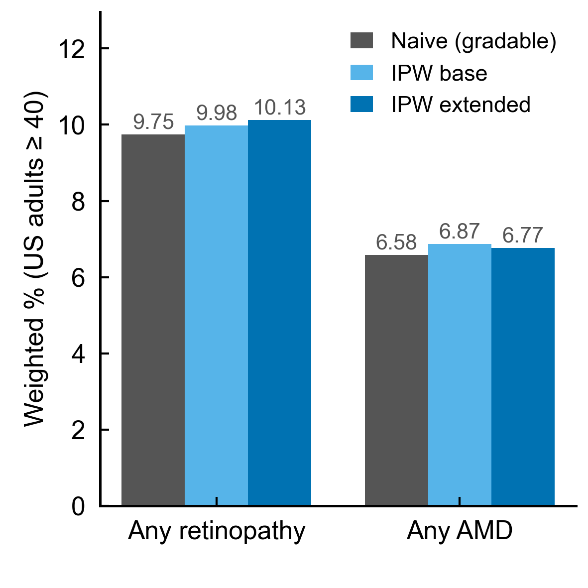
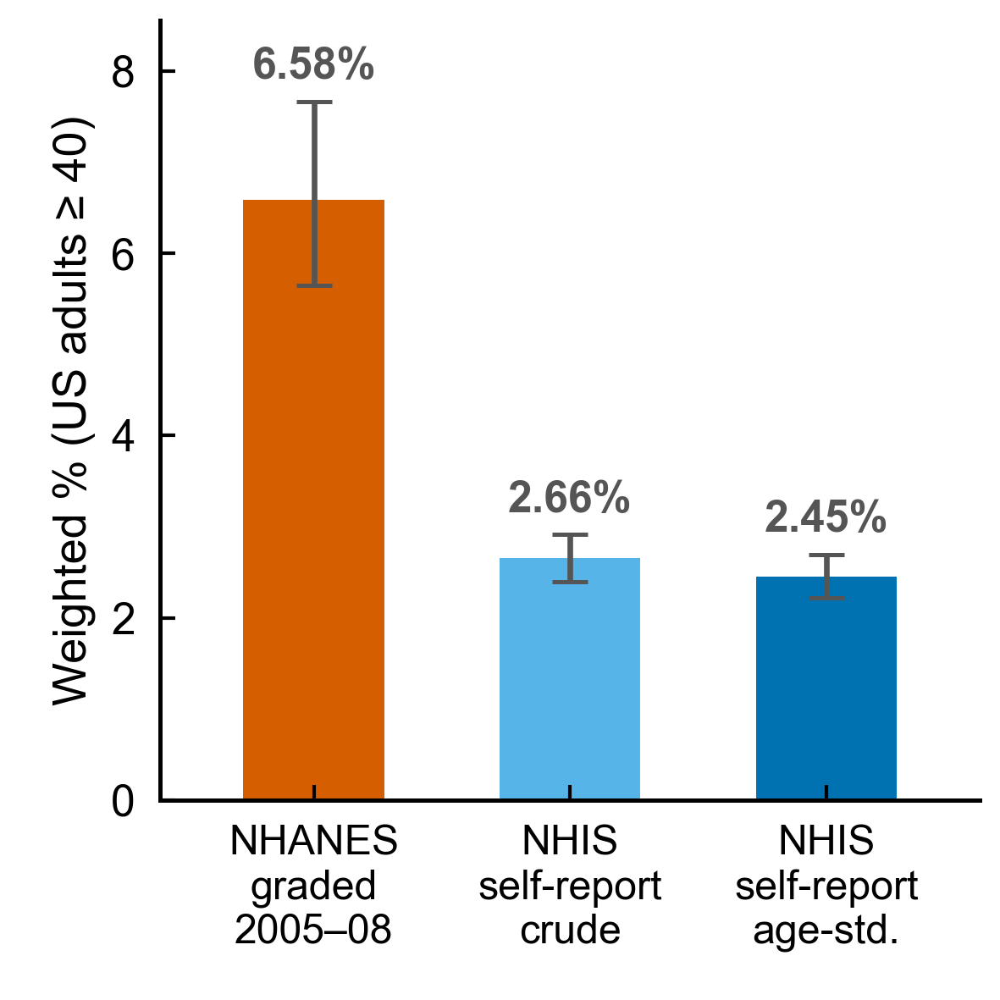

# Supplementary Materials

## Objectively graded retinal disease, self-reported diagnosis, and eye-care utilisation in US adults (NHANES 2005–2008)

*Supplementary values are generated by `code/survey_analysis_v4.R`–`v7.R`, consolidated in `results/tables/numbers_v7.csv` and audited by `code/verify_v7.py`; figures by `code/build_figures_v13.py`. Discordance denominators are responders-only. Proportion CIs are design-based logit (`svyciprop(method="logit")`); adjusted-odds-ratio CIs use the design t critical value at each model's residual degrees of freedom, matching the Wald P values. Tables and figures are numbered by first appearance in the main text; sub-parts are lettered (a)/(b)/(c) within a table.*

---

### Supplementary Figure S1. Grading-feasibility sensitivity (naive versus inverse-probability-weighted prevalence)

*Naive (gradable-only) versus inverse-probability-weighted prevalence of any retinopathy and any AMD under base (age, sex, race) and extended (+ diabetes, insurance, education) gradability models; bars show 95% CIs. IPW shifts each estimate by ≤0.6 percentage points. Weight decomposition in Supplementary Table S8.*

### Supplementary Figure S2. Objectively graded versus self-reported AMD: NHANES imaging compared with NHIS self-report

*NHANES objectively graded AMD (2005–2008, weighted 6.58%) versus NHIS self-reported macular degeneration (2016; crude 2.66%, age-standardised 2.45% to the NHANES 40+ structure); bars show 95% CIs. The surveys differ in instrument, year and method and are shown only as a contextual comparison. Detail in Supplementary Table S4.*

---

### Supplementary Table S1. Variable provenance (NHANES codes, official labels, valid values, analysis recoding)

Official labels are taken verbatim from the NHANES public-use files; valid-value counts are in the examined ≥40 sample. Exact self-report wording should be read from the NHANES questionnaire (Reference 13).

| Variable | Official label (from data file) | Values used | Analysis recoding | Missing handling | Source file |
|---|---|---|---|---|---|
| `OPDUARMA` | Any retinopathy, worse eye | 0 none (4,994) / 1 any (710) / ungradable NA (1,093) | any retinopathy = 1 | ungradable NA excluded | OPH_UE (retinal) |
| `OPDURL4` | 4-level retinopathy severity, worse eye | 1 none (4,994) / 2 mild NPDR (573) / 3 moderate NPDR (106) / 4 severe-or-proliferative (31) / NA ungradable (1,093) | used as ordinal severity factor; **mild NPDR is the regression reference** within the retinopathy cohort | ungradable NA excluded | OPH_UE (retinal) |
| `OPDUARM` | Age-related maculopathy, 3 severity levels, worse eye | 0 none (5,163) / 1 early (386) / 2 late (55) / NA ungradable (1,193) | AMD present = ≥1; late AMD = 2 | ungradable NA excluded | OPH_UE (retinal) |
| `OPDUGA` | Geographic atrophy, worse eye | 0 (5,593) / 1 (32) / NA ungradable | late-AMD phenotype | NA excluded | OPH_UE (retinal) |
| `OPDUEXU` | Exudative (neovascular) AMD, worse eye | 0 (5,622) / 1 (23) / NA ungradable | late-AMD phenotype (mutually exclusive with GA here) | NA excluded | OPH_UE (retinal) |
| `DIQ010` | Doctor told you have diabetes (diagnosed diabetes) | 1 yes (used to define diabetes) | diabetes = 1 | — | DIQ |
| `DIQ080` | Ever told diabetes affected the eyes / retinopathy (asked only if DIQ010 = 1) | 1 yes / 0 no / refused-DK/missing NA | diagnosis reported = 1; **responders-only** | NA = non-responder, excluded | DIQ |
| `DIQ360` | Last time pupils dilated for eye exam (asked only if DIQ010 = 1) | <1 mo / 1–12 mo / 13–24 mo / >2 yr / never | examined-within-12-mo = first two categories | NA = non-responder, excluded | DIQ |
| `VIQ310` | Ever told had macular degeneration | 1 yes / 0 no / NA | AMD diagnosis reported = 1; responders-only | NA excluded | VIQ |
| `VIQ090` | Ever told had glaucoma | 1 / 0 / NA | descriptive | NA excluded | VIQ |
| `VIQ071` | Ever had cataract surgery | 1 / 0 / NA | descriptive | NA excluded | VIQ |
| `HIQ011` | Health-care coverage | yes / no | insured vs uninsured | — | HIQ |
| `HUQ030` | Usual source of care | categories | descriptive | — | HUQ |
| `WTMEC2YR` | 2-year MEC examination weight | continuous | ÷ 2 when pooling cycles E+F | — | DEMO |
| `SDMVSTRA`/`SDMVPSU` | Masked pseudo-stratum / pseudo-PSU | integers | design identifiers | — | DEMO |

*All retinal outcomes are person-level **worse-eye** variables; the self-report items are patient-reported constructs. Valid-value counts are for the full examined ≥40 sample and differ from the disease-restricted denominators in Table S5.*

### Supplementary Table S2. Regression coefficients and design-degrees-of-freedom audit (all estimates read from the same fitted model object)

**(a) Design degrees of freedom contributing to each analytic subset.**

| Analytic subset | Unweighted n | Number of strata | Total number of PSUs | Design degrees of freedom (`survey::degf`) |
|---|---|---|---|---|
| DR responders (313) | 313 | 31 | 59 | 28 |
| AMD responders (436) | 436 | 31 | 61 | 30 |
| DR core complete-case model (187) | 187 | 30 | 52 | 22 |
| AMD core complete-case model (226) | 226 | 31 | 60 | 29 |

*PSUs are unique stratum×PSU combinations; design df = total PSUs − strata, obtained with `survey::degf()`. Design df, model residual df and the `summary.svyglm` df are distinct — regression inference uses residual df = degf − rank + 1 (panel b).*

**(b) Per-model degrees-of-freedom and estimate audit.**

| Model | n | Design df (`degf`) | Rank | Residual df | CI multiplier t(0.975, df) | Term | aOR (95% CI) | Raw P | Holm P |
|---|---|---|---|---|---|---|---|---|---|
| PRIMARY DR core | 187 | 22 | 6 | 17 | 2.110 | Age (per yr) | 0.99 (0.96–1.02) | 0.65 | 1.00 |
| | | | | | | Male | 1.29 (0.45–3.71) | 0.62 | 1.00 |
| | | | | | | Education <HS | 0.67 (0.28–1.61) | 0.35 | 1.00 |
| | | | | | | Race non-White | 1.57 (0.49–5.07) | 0.43 | 1.00 |
| | | | | | | Poverty-income ratio | 1.34 (0.92–1.96) | 0.119 | 0.594 |
| PRIMARY AMD core | 226 | 29 | 6 | 24 | 2.064 | Age (per yr) | 0.93 (0.89–0.96) | 0.00061 | 0.0031 |
| | | | | | | Male | 0.99 (0.32–3.08) | 0.98 | 1.00 |
| | | | | | | Education <HS | 0.82 (0.31–2.21) | 0.69 | 1.00 |
| | | | | | | Race non-White | 1.56 (0.29–8.52) | 0.59 | 1.00 |
| | | | | | | Poverty-income ratio | 0.88 (0.60–1.31) | 0.52 | 1.00 |
| SUPP DR + insurance | 187 | 22 | 7 | 16 | 2.120 | Poverty-income ratio | 1.39 (0.96–2.00) | 0.077 | 0.463 |
| | | | | | | Uninsured | 1.87 (0.57–6.13) | 0.28 | 1.00 |
| ANALYSIS A (eye-care) | 187 | 22 | 10 | 13 | 2.160 | Poverty-income ratio | 1.49 (1.04–2.15) | 0.033 | 0.261 |
| | | | | | | Uninsured | 0.72 (0.17–2.97) | 0.62 | 1.00 |
| | | | | | | **Recent dilated exam** | **0.30 (0.10–0.92)** | **0.038** | **0.266** |
| | | | | | | Severity grade 3 | 0.43 (0.15–1.21) | 0.102 | 0.614 |
| | | | | | | Severity grade 4 | 0.05 (0.01–0.24) | 0.0011 | 0.0099 |

*Every aOR, CI, SE, raw P and Holm P above was extracted programmatically from the single `svyglm` object for that model (keys `audit|*` in `numbers_v7.csv`); CIs use `exp(coef ± t(0.975, dfres)·SE)` at the residual df in the same row, so CI and P are mutually consistent. Holm adjustment is applied within each model.*

**(c) Complete eye-care–awareness model (analysis A), adults with diabetes + objective retinopathy, responders, n = 187.** Outcome = no self-reported diabetic-eye diagnosis. **Mild NPDR is the severity reference** (levels present: mild 197, moderate 85, severe 31).

| Term | aOR (95% CI) | Raw P | Holm P |
|---|---|---|---|
| Recent dilated exam (within 12 mo) | 0.30 (0.10–0.92) | 0.038 | 0.27 |
| Age (per year) | 1.00 (0.97–1.03) | 0.872 | 1.00 |
| Male vs female | 1.09 (0.35–3.38) | 0.876 | 1.00 |
| Education <HS vs ≥HS | 0.90 (0.26–3.07) | 0.852 | 1.00 |
| Race non-White vs White | 1.90 (0.58–6.23) | 0.262 | 1.00 |
| Poverty-income ratio (per unit) | 1.49 (1.04–2.15) | 0.033 | 0.26 |
| Uninsured vs insured | 0.72 (0.17–2.97) | 0.625 | 1.00 |
| Moderate NPDR (ref = **mild NPDR**) | 0.43 (0.15–1.21) | 0.102 | 0.61 |
| Severe-or-proliferative retinopathy (ref = **mild NPDR**) | 0.05 (0.01–0.24) | 0.0011 | **0.010** |

*Exploratory model; intervals use the design t critical value at residual df = 13. Only severe-or-proliferative retinopathy stayed significant after within-model Holm correction. Unadjusted, 82.0% (70.1–89.9) of those not examined within 12 months (n = 106) reported no diabetic-eye diagnosis versus 64.5% (55.9–72.2) of those examined (n = 207); model-adjusted (g-computation) predicted probability 81.8% vs 62.4% — descriptive point estimates, a design interval was unreliable given the sparse strata and is not reported (see main-text Figure 3). Eye-care × severity interaction aOR 1.61 (0.24–10.79), P = 0.59 — no evidence of effect modification.*

### Supplementary Table S3. Missing-data sensitivity for the DR cohort: complete-case, missing-indicator, reduced models, and multiple imputation

**(a) Four handling strategies** for the two high-missingness covariates (education, income): complete-case core model (n = 187); missing-indicator model retaining all 313 responders (median-filled income + missingness flags); reduced model dropping education (n = 283); and multiple imputation (m = 20, Rubin-pooled, n = 313).

| Term | Complete-case (n = 187) aOR (95% CI), Holm P | Missing-indicator (n = 313) aOR (95% CI), P | Reduced — drop education (n = 283) aOR (95% CI), P | Multiple imputation (m = 20, n = 313) aOR (95% CI), P |
|---|---|---|---|---|
| Age (per year) | 0.99 (0.96–1.02), 1.00 | 1.00 (0.97–1.03), 0.935 | 1.00 (0.97–1.03), 0.842 | 1.00 (0.98–1.03), 0.776 |
| Male vs female | 1.29 (0.45–3.71), 1.00 | 0.93 (0.44–1.96), 0.832 | 0.80 (0.36–1.75), 0.558 | 0.99 (0.49–2.01), 0.987 |
| Education <HS vs ≥HS | 0.67 (0.28–1.61), 1.00 | 0.86 (0.38–1.95), 0.711 | excluded by design | 0.76 (0.33–1.79), 0.527 |
| Race non-White vs White | 1.57 (0.49–5.07), 1.00 | 1.27 (0.72–2.25), 0.397 | 1.18 (0.67–2.06), 0.553 | 1.38 (0.82–2.34), 0.221 |
| Poverty-income ratio | 1.34 (0.92–1.96), 0.59 | 1.48 (1.10–1.99), 0.013 (median-filled) | 1.46 (1.08–1.97), 0.017 | 1.38 (1.02–1.87), 0.037 |
| Income-missing indicator | — | 1.08 (0.33–3.56), 0.894 | — | — |
| Education-missing indicator | — | 0.70 (0.30–1.60), 0.375 | — | — |

*The income estimate is above 1 in every specification (1.34–1.48) — the direction is stable but precision depends on missing-data handling, so higher income is a tentative correlate, not an established driver. These results do not establish that the missingness mechanism is ignorable. Attrition: entrants (n = 187) vs excluded (n = 126) were similar on the outcome (66.8% vs 68.3%) and differed mainly in age (65.2 vs 61.6 years).*

**(b) Imputation diagnostics (DR responders, n = 313).** Missingness: education 32.6%, income 9.6%; all other imputation variables 0%. The income aOR was above 1 in each of the 20 imputations (pooled 1.388, range 1.24–1.49, SD 0.048; keys `mimi|*`). These are **not 20 independent replications** — they share the same data and assumptions — and convergence diagnostics were not generated, so this is a limited stability check only; multiple imputation does not reproduce the survey-design variance.

**(c) Missingness-mechanism models (descriptive).** Education-missingness was associated with younger age (OR 0.94/yr) and insurance (both P < 0.001) but **not** with the outcome (OR 0.995, P = 0.99); income-missingness with race/ethnicity (non-White OR 4.11, P = 0.011) but **not** with the outcome (OR 1.21, P = 0.73). These do not establish a missing-at-random mechanism and cannot exclude unobserved bias. A reduced model dropping both education and income (n = 313) left age, sex and race, none associated with the outcome (all P > 0.5); because it excludes income it does not test the consistency of the income association above.

### Supplementary Table S4. NHIS 2016 benchmark: self-reported eye disease, eye-care use, direct age-standardisation and denominator trace

**(a) NHIS 2016 self-reported eye disease and eye-care utilisation (US adults ≥40).** This is the cross-survey benchmark referenced in the main text.

| Measure (NHIS 2016, adults ≥40) | Unweighted n | Weighted % (95% CI) |
|---|---|---|
| Diabetic retinopathy (ever told) | 22,330 | 1.27 (1.09–1.46) |
| Macular degeneration (ever told) | 22,310 | 2.66 (2.40–2.91) |
| Saw eye doctor within 12 months | 22,112 | 48.71 (47.69–49.72) |
| Dilated eye exam within 12 months | 22,142 | 49.93 (48.87–51.00) |
| Dilated eye exam within 12 months, among adults with diabetes | 3,261 | 67.73 (65.59–69.88) |

*Denominator trace for the 1.27% figure: NHIS asks the eye item (VIM_DREV) of ALL Sample Adults without a diabetes branch screener, unlike NHANES DIQ080 (asked only of those reporting diabetes), so 1.27% is a whole ≥40 self-reported prevalence (n = 22,330), not a rate among NHIS diabetics. A diabetes-restricted analogue (8.18%) is in `results/sr_nhis_dr_denom_trace_v10.csv`.*

**(b) Direct age-standardisation of the NHIS self-reported macular-degeneration proportion to the NHANES 40+ structure.**

| Age band | NHIS weighted rate (%) | Standard-population weight (NHANES) |
|---|---|---|
| 40–49 | 0.47 | 0.3358 |
| 50–59 | 1.05 | 0.2894 |
| 60–69 | 2.48 | 0.1832 |
| 70–79 | 5.26 | 0.1207 |
| 80+ | 12.71 | 0.0709 |
| **Crude weighted (≥40)** | **2.66 (2.40–2.91)** | — |
| **Directly age-standardised (design covariance)** | **2.45 (2.22–2.69)** | — |

*Standard weights are the survey-weighted NHANES 40+ distribution across the five bands (80+ includes the 85+ top-coded group). The standardised CI uses the full design covariance between bands, widening it slightly (2.23–2.68 → 2.22–2.69).*

**(c) Standardisation with full design covariance and an age-and-sex variant.**

| Quantity | Estimate (%) | 95% CI | Method |
|---|---|---|---|
| NHIS crude weighted (≥40) | 2.66 | 2.40–2.91 | design-based mean of self-reported macular degeneration |
| NHIS age-standardised | 2.45 | 2.22–2.69 | reweighting identity; full design covariance; standard weights fixed |
| NHIS age-and-sex-standardised | 2.46 | 2.22–2.70 | ten age×sex cells; joint NHANES weights; same method |

*Standard weights are fixed, so each interval is conditional on them. Age-and-sex (2.46%) ≈ age-only (2.45%). Because NHANES (2005–2008 imaging) and NHIS (2016 self-report) differ in year and instrument, the 6.58%-vs-2.45% gap cannot be attributed solely to under-diagnosis.*

**(d) Additional NHIS 2016 self-reported eye disease (outside the objective-versus-reported comparison).**

| Measure (NHIS 2016, adults ≥40) | Unweighted n | Weighted % (95% CI) |
|---|---|---|
| Glaucoma (ever told) | 22,332 | 3.97 (3.66–4.28) |
| Cataract (ever told you have cataract) | 22,343 | 21.17 (20.37–21.96) |

*Construct mismatch: the NHIS item is "ever told you have cataract" while the NHANES figure (Supplementary Table S5d) is cataract-**surgery** history — different endpoints, not compared. NHIS glaucoma has no NHANES imaging analogue.*

### Supplementary Table S5. Screening, per-variable missingness, model-denominator reconciliation, and additional NHANES descriptive context

**(a) Cohort build-up (NHANES 2005–2008, examined adults ≥40).**

| Step | DR cohort | AMD cohort |
|---|---|---|
| Examined adults ≥40 with retinal photography | 6,797 | 6,797 |
| Gradable retinal image (worse eye) | 5,704 | 5,604 |
| Objectively graded disease present | 319 (diabetes + retinopathy) | 441 (any AMD) |
| Answered the self-report diagnosis item → **primary gap denominator** | **313** | **436** |
| Non-responders excluded | 6 | 5 |

**(b) Per-variable missingness among gap-eligible responders.**

| Cohort | Eligible (responders) | Missing education | Missing income | Missing insurance | Missing usual source | Missing dilated-exam item |
|---|---|---|---|---|---|---|
| DR | 313 | 102 | 30 | 0 | 0 | 0 |
| AMD | 436 | 188 | 42 | 1 | 0 | 377 |

*The AMD dilated-exam item is missing for 377/436 because `DIQ360` is asked only of people with diabetes; only 59 AMD responders were diabetic, so the eye-care–awareness analysis cannot be run for AMD.*

**(c) Model-denominator reconciliation.**

| Quantity | DR | AMD |
|---|---|---|
| Descriptive diagnosis-gap denominator (responders) | 313 | 436 |
| Core complete-case model (education AND income complete) | 187 | 226 |
| Core + insurance (education, income, insurance complete) | 187 | — |
| Missing-indicator sensitivity model (retains all responders; income median-filled + income & education missingness flags) | 313 | — |
| Multiple-imputation model (m = 20, Rubin-pooled; retains all responders) | 313 | — |
| Reduced model (education dropped, income kept) | 283 | — |
| Education-complete subset — **descriptive count only, not a fitted model** | 211 | — |
| Insurance descriptive (coverage known) | — | 225 |

*The reduction from 313 (436) to the core 187 (226) is driven by missing education and income. The missing-indicator model retains all 313 responders and is a stability check, not evidence that missingness is ignorable; it is distinct from the education-complete count of 211, which is descriptive only. **AMD insurance (moved here because it is not a fitted term):** among the 225 AMD responders with known coverage, 177/211 insured (83.9%) and 14/14 uninsured reported no prior diagnosis; the uninsured stratum perfectly separated from the outcome, so an insured-vs-uninsured OR is not estimable and AMD excludes insurance.*

**(d) Additional NHANES descriptive measures (moved out of the main prevalence table).** These are **not** part of the objective-versus-reported comparison.

| Measure (NHANES 2005–2008, examined ≥40) | Unweighted n | Weighted % (95% CI) |
|---|---|---|
| Any health insurance | 6,788 | 87.4 (85.1–89.4) |
| Self-reported glaucoma diagnosis | 6,760 | 5.06 (4.41–5.80) |
| Self-reported cataract surgery (VIQ071) | 6,790 | 11.07 (10.03–12.21) |

*Construct: NHANES records cataract-**surgery** history (`VIQ071`), unlike the NHIS "ever told you had cataract" item in Supplementary Table S4(d); the two are not compared.*

### Supplementary Table S6. Extreme-scenario non-response bounds (survey-weighted, not simple count arithmetic)

| Cohort | Responders-only (primary) | If all non-responders were "diagnosed" | If all non-responders were "undiagnosed" |
|---|---|---|---|
| DR (n = 319 base; 6 non-responders) | 70.2 (63.8–75.9) | 69.2 (62.5–75.2) | 70.6 (64.4–76.1) |
| AMD (n = 441 base; 5 non-responders) | 82.2 (77.3–86.2) | 81.6 (76.7–85.7) | 82.3 (77.5–86.3) |

*Bounds were recomputed with the full survey weights (non-responders set to all-diagnosed then all-undiagnosed), not by count arithmetic. The primary estimate lies within the ~1–1.4-point bounds, so the headline gaps are not driven by the few non-responders.*

### Supplementary Table S7. Diagnosis discordance by severity, stage and age (survey-weighted % with no self-reported diagnosis; responders; logit CIs)

**(a) DR diagnosis gap by retinopathy severity.**

| Stratum | Unweighted n | % (95% CI) |
|---|---|---|
| Any retinopathy (primary) | 313 | 70.2 (63.8–75.9) |
| Mild NPDR (OPDURL4 = 2) | 197 | 78.1 (71.3–83.7) |
| Moderate NPDR (OPDURL4 = 3) | 85 | 64.4 (48.3–77.8) |
| Severe-or-proliferative (OPDURL4 = 4) | 31 | 15.7 (5.0–39.7) |
| Moderate-or-worse (pooled, **overlapping** summary) | 116 | 53.4 (38.7–67.5) |

**(b) Self-reported diabetic-eye diagnosis (percent *diagnosed*) by severity, for contrast.**

| Stratum | Unweighted n | % diagnosed |
|---|---|---|
| No gradable retinopathy (OPDURL4 = 1) | 560 | 16.6 |
| Mild NPDR | 197 | 21.9 |
| Moderate NPDR | 85 | 35.6 |
| Severe-or-proliferative | 31 | 84.3 |

**(c) AMD diagnosis gap by stage and late phenotype.**

| Stratum | Unweighted n | % (95% CI) |
|---|---|---|
| Any AMD (primary, all stages) | 436 | 82.2 (77.3–86.2) |
| Early AMD | 381 | 87.9 (84.4–90.6) |
| Late AMD (clinically relevant) | 55 | 41.4 (25.3–59.6) |
| Geographic atrophy (high-severity) | 32 | 50.3 (26.6–73.9) |
| Exudative / neovascular AMD (high-severity) | 23 | 27.7 (8.0–62.9) |

**(d) Diagnosis gap by age stratum.**

| Cohort / band | Unweighted n | % (95% CI) |
|---|---|---|
| AMD 40–59 | 75 | 99.1 (95.6–99.8) |
| AMD 60–74 | 165 | 86.6 (77.8–92.3) |
| AMD ≥75 | 196 | 66.7 (60.1–72.6) |
| AMD ≥50 | 406 | 79.7 (75.0–83.8) |
| DR 40–59 | 101 | 73.4 (59.9–83.6) |
| DR 60–74 | 156 | 66.5 (58.6–73.6) |
| DR ≥75 | 56 | 71.1 (56.0–82.7) |

*The severity counts (560/197/85/31 = 873) are diabetes-restricted gradable responders who answered `DIQ080`; the retinopathy subset (197+85+31 = 313) equals the primary DR denominator. Early/late AMD gaps use their own responder sets (381, 55), not percentage subtraction. Late-AMD and high-severity strata are small and reported as design-weighted proportions only; the geographic-atrophy vs neovascular difference has wide, overlapping intervals and is not an established group difference. The two late-AMD phenotypes are separate flags (`OPDUGA`, `OPDUEXU`) and no worse eye carried both (0 of 55), so 32 + 23 = 55 reproduces the late total; a bilateral-mixed pattern could be undercounted, so read these as an approximately mutually exclusive partition.*

### Supplementary Table S8. Grading feasibility: gradable vs ungradable comparison and inverse-probability-weighted prevalence

**(a) Observable characteristics of gradable vs ungradable images (person-level, examined ≥40).**

| Group | n | Mean age | Male % | Diabetes % | Non-White % | Insured % | Education <HS % |
|---|---|---|---|---|---|---|---|
| Gradable (retinopathy) | 5,704 | 59.6 | 50.1 | 15.9 | 46.4 | 83.7 | 14.4 |
| Ungradable | 1,093 | 64.5 | 47.3 | 22.1 | 55.4 | 86.2 | 23.2 |

*Ungradable-image participants were older, more often diabetic and less often high-school-educated.*

**(b) Naive vs inverse-probability-weighted (IPW) whole-population prevalence, and full weight decomposition.**

| Measure | Naive (gradable-only) % | IPW, base model % | IPW, extended model % |
|---|---|---|---|
| Any retinopathy (all ≥40) | 9.75 | 9.98 | 10.13 |
| Any AMD (all ≥40) | 6.58 | 6.87 | 6.77 |

The large values below are the **combined survey weight** (baseline MEC weight × inverse-probability factor), not the inverse-probability factor itself, which is modest.

| Quantity (over the 5,704 gradable respondents) | Base model (age, sex, race) | Extended model (+ diabetes, insurance, education) |
|---|---|---|
| Gradability probability P (min / median / max) | 0.637 / 0.849 / 0.938 | 0.569 / 0.915 / 1.000 |
| Observations truncated by the 0.05 probability floor | 0 | 0 |
| Inverse-probability factor 1/P (min / median / max) | 1.07 / 1.18 / 1.57 | 1.00 / 1.09 / 1.76 |
| Combined survey weight (median / max) | 16,566 / 110,456 | 15,545 / 115,872 |
| Kish effective sample size of the combined weights | 3,656 | 3,635 |
| Kish effective sample size of the raw (un-IPW'd) weights | 3,508 | 3,508 |
| Complete-case rows used to *fit* the gradability model | 6,797 | 3,687 |

*Gradability was modelled with base (age, sex, race) and extended (+ diabetes, insurance, education) specifications; respondents were reweighted by 1/P with a 0.05 floor. The smallest P was 0.637 (base) and 0.569 (extended), so the floor was **never binding**. The extended model fitted only 3,687 complete-covariate respondents (vs 6,797), so it targets a slightly different effective population. IPW moved prevalence by ≤0.6 points; combined-weight ESS ≈ raw-weight ESS is a **limited stability check only**. IPW corrects for observable differences; unobserved grading selection remains possible.*

**(c) Discordance-specific selection sensitivity (does the gap itself depend on gradability weighting?).**

| Outcome | Responders, standard weights | IPW for gradability (extended model) |
|---|---|---|
| DR diagnosis gap | 70.2 (63.8–75.9) | 70.2 (64.1–75.6) |
| AMD diagnosis gap | 82.2 (77.3–86.2) | 82.0 (77.1–86.0) |

*Reweighting the DR and AMD responder sets by 1/P(gradable) barely changed the gaps (DR 70.2→70.2; AMD 82.2→82.0); this still cannot exclude unmeasured selection among ungradable participants.*

### Supplementary Table S9. Is the AMD age gradient independent of disease severity?

The AMD diagnosis gap falls steeply with age (from ~99% in the youngest band to ~67% in the oldest). Because older participants also carry more late AMD, we tested whether the gradient is a proxy for severity (both at the residual df of the same objects as Table S2b).

**(a) Age adjusted for AMD stage (logistic, no-reported-diagnosis outcome).**

| Term | aOR (95% CI) | Raw P | Holm P |
|---|---|---|---|
| Age (per year) | 0.92 (0.89–0.95) | 7.9 × 10⁻⁶ | 2.4 × 10⁻⁵ |
| Late vs early stage | 0.18 (0.08–0.37) | 6.1 × 10⁻⁵ | 1.2 × 10⁻⁴ |
| Male | 1.02 (0.52–1.98) | 0.96 | 0.96 |

*n = 436 AMD responders with a gradable stage; design df = 30, rank = 4, residual df = 27, t(0.975, 27) = 2.052. Adjusting for severity barely changes the age term (0.93 → 0.92/yr), and late stage is independently associated with a much lower gap.*

**(b) Age strata within early AMD only (severity held roughly constant).**

| Stratum | Unweighted n | Gap % (95% CI) |
|---|---|---|
| Early AMD, age 40–59 | 74 | 99.1 (95.6–99.8) |
| Early AMD, age 60–69 | 86 | 92.4 (80.5–97.3) |
| Early AMD, age 70+ | 221 | 78.4 (72.9–82.9) |

*Within early AMD the gap still falls with age (99.1% → 92.4% → 78.4%). Together with (a) this shows the age gradient is not an artefact of older people being more severely affected; it is consistent with greater cumulative eye-care contact with age, but the cross-sectional design cannot establish that ageing causes higher awareness.*
